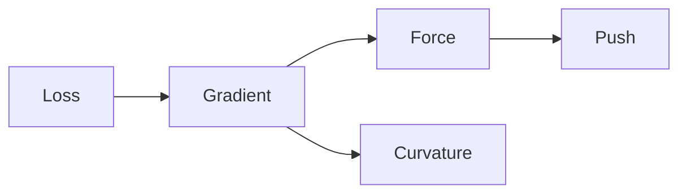

::: use title title="doc-kit: an example deck" author="Your Name" date="2026"

---
<!-- slide section="Basics" -->
## Heading + body

- Markdown bullets, **bold**, `code`, and inline math $e^{i\pi} + 1 = 0$.
- Display math works anywhere:
$$\mathcal L(\theta) = \frac1N\sum_i \norm{R[u_\theta](x_i)}^2$$

::: steps
- This bullet appears on the first click.
- This one on the second.
:::

::: notes
Speaker notes go here. Press **s** to open the speaker view.
:::

---
<!-- slide layout=equation -->
## Term-by-term reveal and highlight

$$\nabla_\theta\mathcal L = 2J_N^\top\Big[\hl{1}{\underbrace{J_P^\top\bar R}_{\text{LS force}}} + \step{2}{\hl{2-}{\underbrace{w\,\bar R}_{\text{push}}}} + \step{3}{\hlb{3}{\underbrace{w^2 I\,\delta}_{\text{floor}}}}\Big]$$

`\step{n}{…}` shows a term from click n; `\hl{n}{…}` highlights it at click n (`2-` = from 2 on, `2-4` = a range).

---
<!-- slide layout=two-col -->
## Two columns, a table with row reveals

::: col
- Left column text.
- A `[[tbd]]` marker renders like this: [[tbd]] or [[tbd: seed 7]].
:::

::: col
::: steps rows
| Method | L2 error |
|---|---|
| Baseline | 1.2e-2 |
| Ours | [[tbd]] |
:::
:::

---
## Mermaid, built up per click



---
<!-- slide layout=figure -->
## Figure + points: CSV plot

::: col 3
```plot
title: Training loss
x: {label: step}
y: {label: loss, log: true}
reveal: series
series:
  - {src: data/loss.csv, y: "baseline - loss", label: Baseline}
  - {src: data/loss.csv, y: "ours - loss", label: Ours}
```
:::

::: col 2
- Reads W&B CSV exports.
- Log scale, min/max bands.
- One curve per click.
:::

---
<!-- slide layout=figure -->
## Analytic plot, missing data, missing figure

::: col
```fnplot
var: z
x: {domain: [-3, 3], label: z}
y: {domain: [-2, 2], label: "f(z)"}
height: 330
curves:
  - {fn: "tanh(z)", label: "tanh z"}
  - {fn: "sin(2*z)/2", label: "sin(2z)/2", step: 1}
hlines: [{y: 1}, {y: -1}]
bands: [{x: [-0.5, 0.5], label: band, step: 2}]
```
:::

::: col
```plot
title: A plot whose CSV is not there yet
series:
  - {src: data/missing.csv, y: "ours - l2", label: Ours}
```

::: figure src=figures/not-yet.png caption="A figure that has not been made yet"
Field plot of something, from a checkpoint.
:::
:::

---
<!-- slide layout=figure -->
## Python plot: the same figure for slides and papers

::: col 3
::: figure src=figures/loss.svg height=440px caption="From data/loss.csv by make_figures.py"
Run python3 talks/example/make_figures.py
:::
:::

::: col 2
- `doc_kit.plots.save(fig, "figures/loss")` writes **loss.svg** (this slide) and **loss.pdf** (for `\includegraphics`).
- The SVG's text follows the slide theme: press **t**.
:::

---
## Math assets from the pack

The same file renders here with KaTeX and in a paper with `\exasset`:

::: use demo/heat

With a parameter, and nested (`kappa` passes through):

::: use demo/residual-loss kappa=0.1

---
::: use demo/pipeline

---
::: use closing
